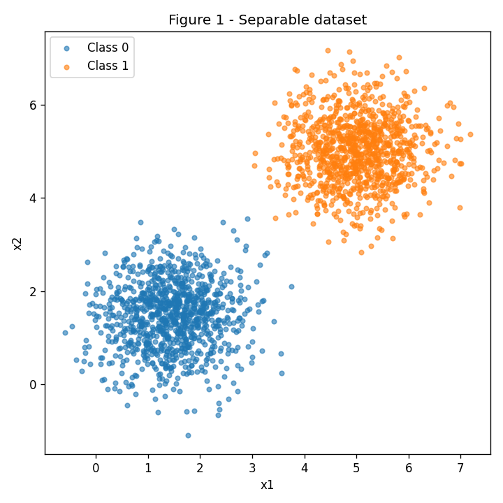
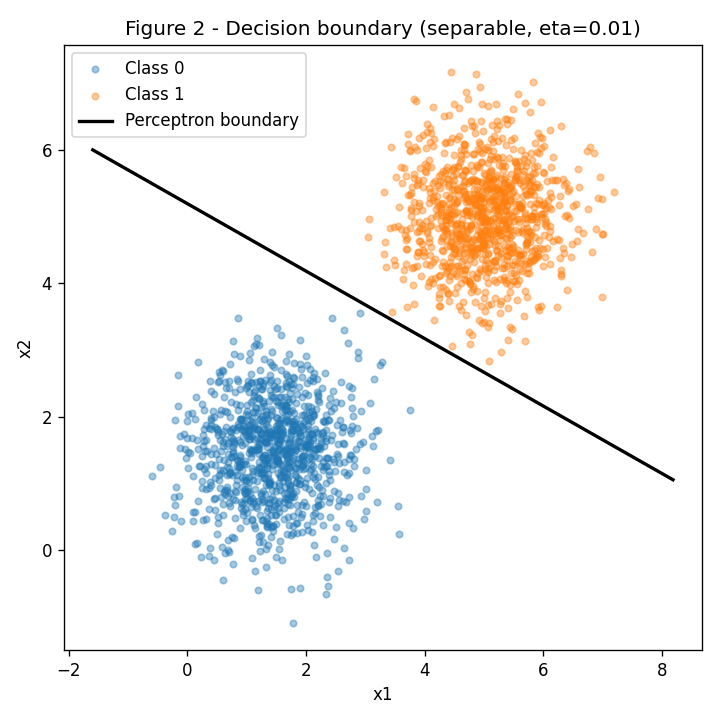
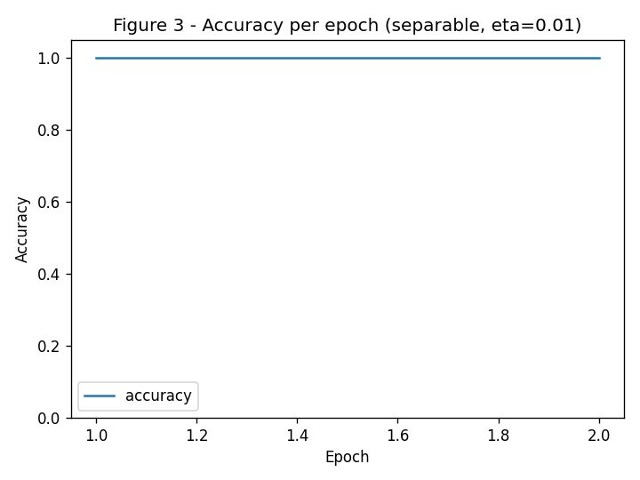
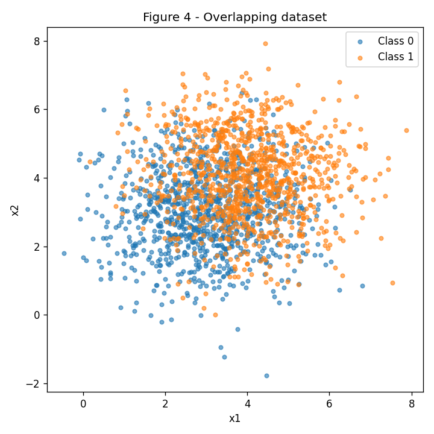
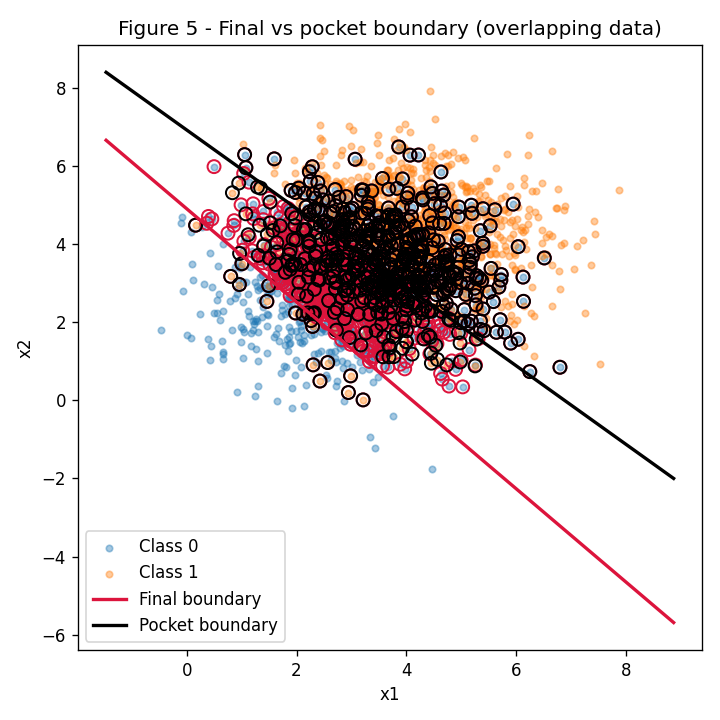
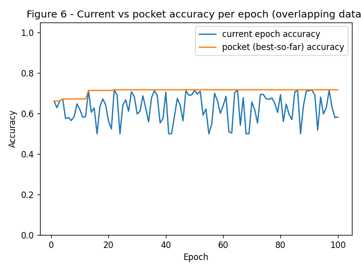

# Perceptron from Scratch — Separability Exercise

**Course:** Insper — Artificial Neural Networks / Deep Learning (2026.2)
**Author:** Stefano Lindenbojm
**Seed used everywhere:** `rng = np.random.default_rng(42)`

All code (data generation and the Perceptron itself) is in a single file,
[`perceptron.py`](https://github.com/{{ site.github.owner_name }}/{{ site.github.repository_name }}/blob/main/perceptron.py),
and running `python3 perceptron.py` regenerates every number and every
figure on this page exactly (fixed seed, no external randomness).

## Approach and challenges

The goal of the exercise is to see what a perceptron *can* and *cannot*
learn. I implemented a single `Perceptron` class from scratch (no
scikit-learn) with the `{0,1}` step activation and the classic update rule
`w <- w + eta*(y - y_hat)*x`. The same class is reused, unchanged, for both
exercises — the only difference is turning on the **pocket** variant
(keeping a copy of the best-ever weights, not just the last ones), which is
required when the data is not linearly separable.

The main challenge was making the experiment fair and reproducible: the
same `rng` object is used for both data generation and for shuffling the
training order every epoch, so re-running the script always gives the
same weights, epoch counts and figures. The overlapping dataset (Exercise
2) never converges, so the "final" weights after 100 epochs can be much
worse than the "pocket" (best-so-far) weights — that is exactly the
phenomenon the pocket algorithm is meant to fix.

---

## Exercise 1 — Separable data

### A. Data

2000 points (1000 per class), sampled from:

- Class 0: mean `[1.5, 1.5]`, covariance `[[0.5, 0], [0, 0.5]]`
- Class 1: mean `[5, 5]`, covariance `[[0.5, 0], [0, 0.5]]`

**Figure 1 — Separable dataset**



### B. Perceptron implementation

```python
class Perceptron:
    """Single-layer perceptron with the classic {0,1} update rule."""

    def __init__(self, n_features, lr=0.01, rng=rng):
        # Small random (non-zero) initial weights, as required.
        self.w = rng.normal(0, 0.01, size=n_features)
        self.b = 0.0
        self.lr = lr

    def step(self, z):
        return np.where(z >= 0, 1, 0)

    def predict(self, X):
        return self.step(X @ self.w + self.b)

    def fit(self, X, y, max_epochs=100, pocket=False):
        for epoch in range(max_epochs):
            updates_in_epoch = 0
            for i in rng.permutation(len(X)):
                y_hat = self.step(X[i] @ self.w + self.b)
                error = y[i] - y_hat
                if error != 0:
                    self.w += self.lr * error * X[i]
                    self.b += self.lr * error
                    updates_in_epoch += 1
            if updates_in_epoch == 0:
                break  # converged
```

(Full version, with accuracy history and the pocket bookkeeping, in
`perceptron.py`.)

### C. Training and results (eta = 0.01)

| quantity | value |
|---|---|
| final w | `[0.0078, 0.0154]` |
| final b | `-0.0800` |
| epochs until convergence | `2` |
| final accuracy | `1.0000` |

**Figure 2 — Decision boundary (misclassified points would be circled; there are none)**



**Figure 3 — Accuracy per epoch**



### D. Analysis

**1. Why does the separable case converge so fast?**
The two classes are far apart (means at distance ~5, standard deviation
~0.7), so almost no points fall on the wrong side of *any* reasonable
line between them. Every time a point is misclassified, the update rule
`w <- w + eta*(y - y_hat)*x` nudges the boundary directly towards fixing
that point (it adds a multiple of `x` in the direction that increases
`w.x+b` for a positive example, or decreases it for a negative one). Because
a separating hyperplane exists and errors are rare, only a couple of
corrective nudges are needed before the boundary sits between the two
clusters with zero errors — hence convergence in 2 epochs.

**2. Re-running with eta = 1.0:**

| quantity | eta = 0.01 | eta = 1.0 |
|---|---|---|
| epochs | 2 | 5 |
| accuracy | 1.0000 | 1.0000 |
| w / \|\|w\|\| | `[0.451, 0.893]` | `[0.694, 0.720]` |

Cosine similarity between the two normalized directions: **0.9554** — close
to but not exactly 1. Both runs reach 100% accuracy, but a larger `eta`
takes more epochs here because each single update overshoots more,
occasionally flipping a previously-correct point back to incorrect before
settling. The final boundary direction is *similar but not identical*
because the initial weights are small random (non-zero) values, not
exactly zero (see item 3 below for why zero-initialization would make it
identical).

**3. Algebraic demonstration (starting from w = 0):**
Suppose `w_0 = 0` and `b_0 = 0`. Every update has the form
`w <- w + eta*(y - y_hat)*x`, so after any sequence of updates,
`w` and `b` are just sums of terms proportional to `eta`:

```
w_k = eta * sum_i (y_i - y_hat_i) * x_i
b_k = eta * sum_i (y_i - y_hat_i)
```

The prediction at every step only depends on the **sign** of
`w.x + b`, which is unchanged if `w` and `b` are both scaled by the same
positive constant. So, starting from zero, whether we use `eta` or `c*eta`
(c > 0), the sequence of predictions `y_hat_i` — and therefore the sequence
of which examples trigger an update — is *exactly the same* at every step.
This means:

- the number of epochs to convergence is identical (same errors occur at
  the same points in the same order), and
- the final weights differ only by the constant factor `c`:
  `w_final(c*eta) = c * w_final(eta)`, `b_final(c*eta) = c * b_final(eta)`.

Since the boundary is defined by `w.x + b = 0`, and
`(c*w).x + (c*b) = c*(w.x + b)`, the zero-set (the boundary itself) is
identical for any `c > 0`. In other words, `eta` only rescales the
weight vector — it does not change the learned boundary or the training
dynamics, *if and only if* training starts exactly at `w = 0, b = 0`. This
is why our two runs above (which start from small non-zero random weights)
show a similar but not perfectly identical direction: the non-zero initial
`w_0` is *not* proportional to `eta`, so it breaks the perfect scaling
argument slightly.

---

## Exercise 2 — Overlapping data (pocket algorithm)

### A. Data

2000 points (1000 per class):

- Class 0: mean `[3, 3]`, covariance `[[1.5, 0], [0, 1.5]]`
- Class 1: mean `[4, 4]`, covariance `[[1.5, 0], [0, 1.5]]`

**Figure 4 — Overlapping dataset**



### B. Training with the pocket algorithm

Same `Perceptron` class as Exercise 1, `eta = 0.01`, 100 epochs max. The
pocket algorithm simply keeps a saved copy of `(w, b)` every time the
accuracy on the **full** dataset beats the best accuracy seen so far:

```python
if pocket:
    if acc > best_acc:
        best_w, best_b, best_acc = self.w.copy(), self.b, acc
```

| | w | b | epochs | accuracy |
|---|---|---|---|---|
| **final** (last epoch's weights) | `[0.1218, 0.1019]` | `-0.5000` | 100 | `0.5830` |
| **pocket** (best-ever weights) | `[0.0683, 0.0679]` | `-0.4700` | 100 | `0.7175` |

### C. Figures

**Figure 5 — Final vs pocket boundary (misclassified points circled)**



**Figure 6 — Current vs pocket (best-so-far) accuracy per epoch**



### D. Analysis

**1. Why the gap between pocket (~72%) and final (~58%)?**
Since the classes overlap heavily, no line can classify every point
correctly — there will always be misclassified examples, so the perceptron
*never* reaches a "no update" epoch and keeps changing its weights forever
(see the noisy blue curve in Figure 6). It simply stops because it hit the
100-epoch limit, at a random point in its oscillation — not because it
found a good solution. The **pocket** copy, on the other hand, only ever
gets overwritten when a strictly better boundary is found, so it
remembers the best line seen across all 100 epochs, which happens to be
much better (~72%) than wherever the perceptron randomly ends up (~58%).

**2. Comparing Figure 3 (separable) with Figure 6 (overlapping):**
The perceptron convergence theorem guarantees that the update rule finds a
zero-error boundary **in a finite number of steps, provided the data is
linearly separable** (a margin between the classes exists). Figure 3 shows
exactly that: accuracy climbs straight to 1.0 and updates stop. Figure 6
violates that assumption — the classes overlap, so no perfect linear
boundary exists, the accuracy oscillates around ~60-70% forever, and the
"no update" stopping condition is never triggered.

**3. Would more epochs or a smaller eta fix it?**
No. The update rule `w <- w + eta*(y - y_hat)*x` only ever stops changing
`w` when every point is correctly classified. If the data is not linearly
separable, some points are misclassified *for every possible linear
boundary*, so there will always be at least one nonzero update term,
regardless of how many epochs are run or how small `eta` is. A smaller
`eta` only makes each step smaller (it does not remove the impossibility
of separating the classes), so it would just slow down the same endless
oscillation instead of stopping it. The only real fix is to use a model
that is not restricted to a linear boundary, or to use the pocket
algorithm's "best-so-far" heuristic instead of expecting true convergence.

---

## Results summary

| Experiment | w1 | w2 | b | epochs | accuracy |
|---|---|---|---|---|---|
| Ex1 (eta=0.01) | 0.0078 | 0.0154 | -0.0800 | 2 | 1.0000 |
| Ex1 (eta=1.0) | 5.3576 | 5.5513 | -36.0000 | 5 | 1.0000 |
| Ex2 final | 0.1218 | 0.1019 | -0.5000 | 100 | 0.5830 |
| Ex2 pocket | 0.0683 | 0.0679 | -0.4700 | 100 | 0.7175 |

Reproducibility: everything above is produced by a single deterministic
script, `perceptron.py`, using `rng = np.random.default_rng(42)` for both
data generation and training-order shuffling. Running `python3
perceptron.py` reproduces every number and figure exactly.
