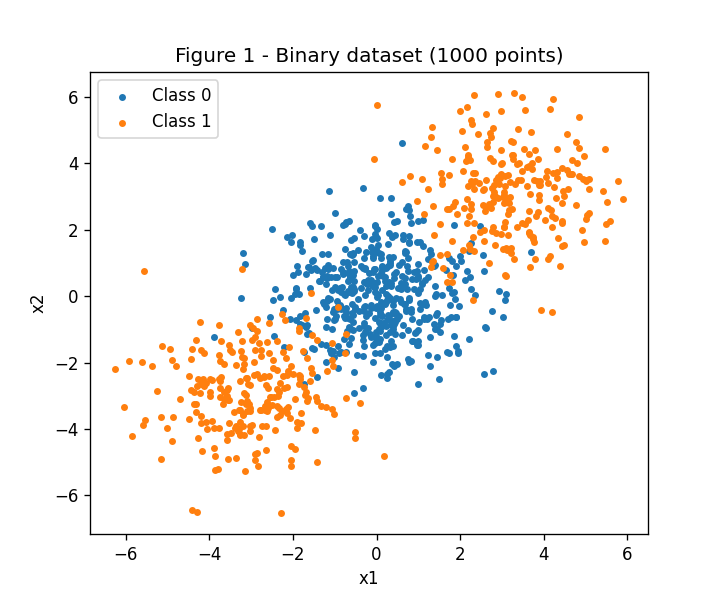
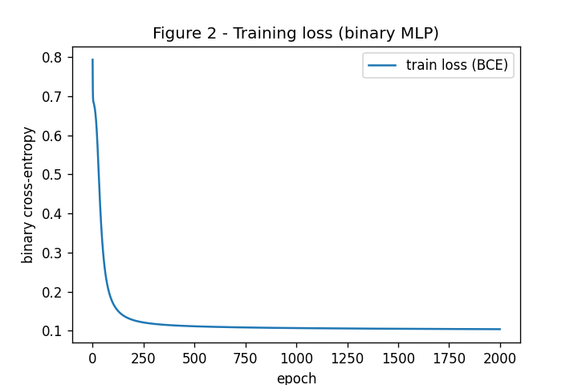
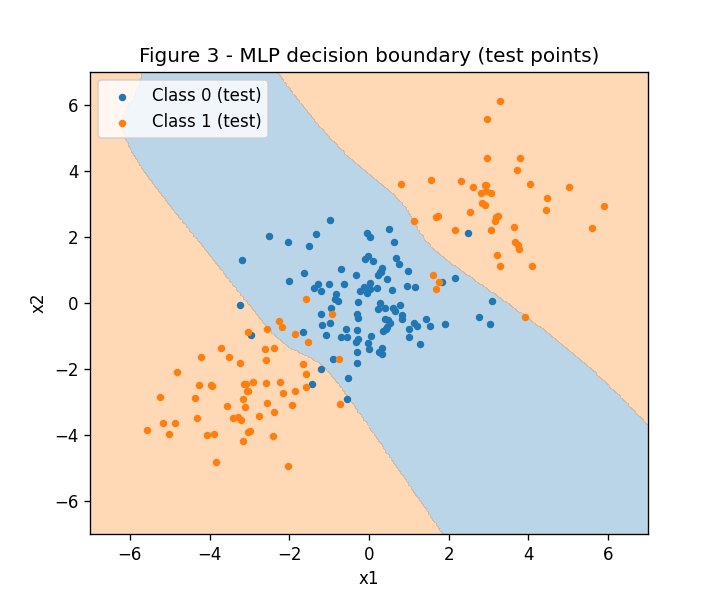
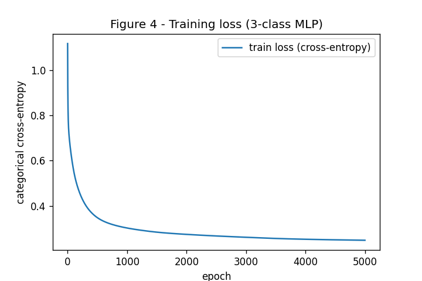
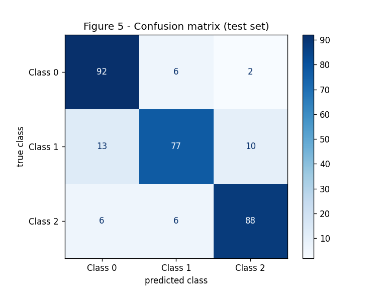
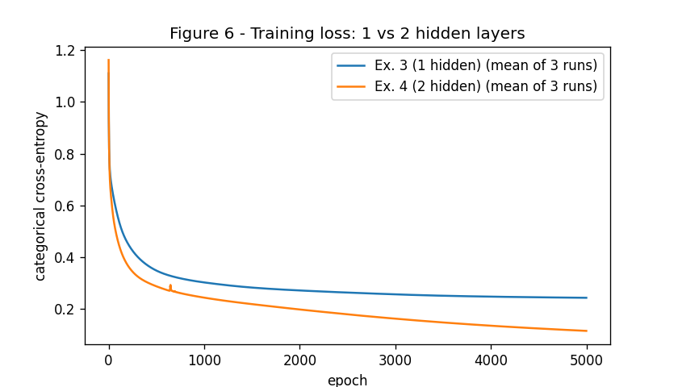

# MLP: Multi-Layer Perceptrons

All scripts use `rng = np.random.default_rng(42)` as the single random generator. The MLP (tanh hidden layers, sigmoid/softmax output, cross-entropy loss, forward pass, backward pass and gradient-descent update) is written by hand with numpy. scikit-learn is used only for `make_blobs` / `make_classification`, `train_test_split`, the `LogisticRegression` baseline and the confusion matrix.

To re-run everything (from the repository root):

```bash
pip install -r requirements.txt
python docs/mlp/code/ex1_check.py
python docs/mlp/code/ex2_binary.py
python docs/mlp/code/ex3_multiclass.py
python docs/mlp/code/ex4_deeper.py
```

The MLP class used in Exercises 2, 3 and 4 (`code/mlp.py`):

```python
# MLP written from scratch with numpy (used by Exercises 2, 3 and 4).
#
# - Hidden layers: tanh
# - Output layer:  sigmoid + binary cross-entropy  (1 output unit)
#                  softmax + categorical cross-entropy (K output units)
#
# Both output/loss pairs have the SAME gradient w.r.t. the output pre-activation:
#     dL/du = (y_hat - y) / N
# so forward(), backward() and update() are exactly the same code for
# binary and multi-class problems. Only the final activation changes.
import numpy as np


class MLP:
    def __init__(self, layer_sizes, rng, lr=0.1):
        # layer_sizes example: [2, 8, 1] = 2 inputs, 8 hidden, 1 output
        self.lr = lr
        self.W = []
        self.b = []
        for n_in, n_out in zip(layer_sizes[:-1], layer_sizes[1:]):
            # small random weights (Xavier-like scale), zero biases
            self.W.append(rng.normal(0, 1 / np.sqrt(n_in), size=(n_in, n_out)))
            self.b.append(np.zeros(n_out))

    def n_params(self):
        return sum(W.size + b.size for W, b in zip(self.W, self.b))

    def output_activation(self, u):
        if u.shape[1] == 1:                        # binary -> sigmoid
            return 1 / (1 + np.exp(-u))
        u = u - u.max(axis=1, keepdims=True)       # multi-class -> softmax (stable)
        e = np.exp(u)
        return e / e.sum(axis=1, keepdims=True)

    def forward(self, X):
        # keep every layer output (needed by backprop)
        self.h = [X]
        for i in range(len(self.W)):
            u = self.h[-1] @ self.W[i] + self.b[i]
            if i < len(self.W) - 1:
                self.h.append(np.tanh(u))                    # hidden layer
            else:
                self.h.append(self.output_activation(u))     # output layer
        return self.h[-1]

    def loss(self, y_hat, Y):
        eps = 1e-12
        if Y.shape[1] == 1:   # binary cross-entropy
            return -np.mean(Y * np.log(y_hat + eps) + (1 - Y) * np.log(1 - y_hat + eps))
        return -np.mean(np.sum(Y * np.log(y_hat + eps), axis=1))  # categorical CE

    def backward(self, Y):
        N = Y.shape[0]
        delta = (self.h[-1] - Y) / N          # dL/du of the output layer
        self.dW = [None] * len(self.W)
        self.db = [None] * len(self.W)
        for i in reversed(range(len(self.W))):
            self.dW[i] = self.h[i].T @ delta
            self.db[i] = delta.sum(axis=0)
            if i > 0:
                # go back one layer: through the weights, then through tanh
                delta = (delta @ self.W[i].T) * (1 - self.h[i] ** 2)

    def update(self):
        for i in range(len(self.W)):
            self.W[i] -= self.lr * self.dW[i]
            self.b[i] -= self.lr * self.db[i]

    def fit(self, X, Y, epochs):
        losses = []
        for _ in range(epochs):
            y_hat = self.forward(X)
            losses.append(self.loss(y_hat, Y))
            self.backward(Y)
            self.update()
        return losses

    def predict(self, X):
        y_hat = self.forward(X)
        if y_hat.shape[1] == 1:
            return (y_hat[:, 0] > 0.5).astype(int)
        return y_hat.argmax(axis=1)


def one_hot(y, n_classes):
    return np.eye(n_classes)[y]
```

[View `mlp.py` on GitHub](https://github.com/stefanolinden/exercises/blob/main/docs/mlp/code/mlp.py)

## Exercise 1

Network: 2 inputs → 2 hidden neurons (tanh) → 1 output (tanh). Loss `L = (y − ŷ)²`.

Values: `x = [0.5, −0.2]`, `y = 1.0`, `W1 = [[0.3, −0.1], [0.2, 0.4]]` (row *i* = weights of hidden neuron *i*), `b1 = [0.1, −0.2]`, `W2 = [0.5, −0.3]`, `b2 = 0.2`, `η = 0.3`.

Useful fact: `tanh'(a) = 1 − tanh(a)²`.

### A

**Hidden layer pre-activation** `z1 = W1·x + b1`

```
z1[1] = 0.3·0.5 + (−0.1)·(−0.2) + 0.1 = 0.15 + 0.02 + 0.1 =  0.2700
z1[2] = 0.2·0.5 +   0.4 ·(−0.2) − 0.2 = 0.10 − 0.08 − 0.2 = −0.1800
```

**Hidden layer activation** `h1 = tanh(z1)`

```
h1[1] = tanh(0.27)  =  0.263625
h1[2] = tanh(−0.18) = −0.178081
```

**Output pre-activation** `u2 = W2·h1 + b2`

```
u2 = 0.5·0.263625 + (−0.3)·(−0.178081) + 0.2
   = 0.131812 + 0.053424 + 0.2 = 0.385237
```

**Output** `ŷ = tanh(u2) = tanh(0.385237) = 0.367247`

**Loss** `L = (1 − 0.367247)² = 0.632753² = 0.400377`

### B

Chain rule, from the loss back to the first layer:

```
∂L/∂ŷ   = −2(y − ŷ)              = −2·0.632753                 = −1.265507
∂L/∂u2  = ∂L/∂ŷ · (1 − ŷ²)       = −1.265507·(1 − 0.134870)    = −1.094828

∂L/∂W2  = ∂L/∂u2 · h1            = −1.094828·[0.263625, −0.178081]
                                 = [−0.288624, 0.194968]
∂L/∂b2  = ∂L/∂u2                 = −1.094828

∂L/∂h1  = ∂L/∂u2 · W2            = −1.094828·[0.5, −0.3]
                                 = [−0.547414, 0.328448]
∂L/∂z1  = ∂L/∂h1 ⊙ (1 − h1²)     = [−0.547414·(1 − 0.069498), 0.328448·(1 − 0.031713)]
                                 = [−0.509370, 0.318032]

∂L/∂W1  = ∂L/∂z1 · xᵀ  (outer product, row i = neuron i)
        = [[−0.509370·0.5, −0.509370·(−0.2)],      [[−0.254685,  0.101874],
           [ 0.318032·0.5,  0.318032·(−0.2)]]  =    [ 0.159016, −0.063606]]
∂L/∂b1  = ∂L/∂z1                 = [−0.509370, 0.318032]
```

### C

Gradient descent: `θ_new = θ − η · ∂L/∂θ` with `η = 0.3`.

| Parameter | Old | Gradient | New |
|---|---|---|---|
| W1[1,1] | 0.3 | −0.254685 | **0.376405** |
| W1[1,2] | −0.1 | 0.101874 | **−0.130562** |
| W1[2,1] | 0.2 | 0.159016 | **0.152295** |
| W1[2,2] | 0.4 | −0.063606 | **0.419082** |
| b1[1] | 0.1 | −0.509370 | **0.252811** |
| b1[2] | −0.2 | 0.318032 | **−0.295410** |
| W2[1] | 0.5 | −0.288624 | **0.586587** |
| W2[2] | −0.3 | 0.194968 | **−0.358490** |
| b2 | 0.2 | −1.094828 | **0.528448** |

The statement says "eight parameters", but W1 (4) + b1 (2) + W2 (2) + b2 (1) is 9 numbers, so all 9 are listed.

**Second forward pass** with the new parameters: `ŷ = 0.711181` and `L = 0.083417`. The loss **goes down** (0.4004 → 0.0834). This is expected: each parameter moved a small step in the direction opposite to its gradient, which is the direction that decreases `L` locally. Because `ŷ` was too small (0.367 vs. 1.0), all updates pushed `ŷ` up, toward the target.

The hand numbers were checked with this script (`code/ex1_check.py`):

```python
# Exercise 1 is done by hand in the report. This script only CHECKS the hand numbers.
import numpy as np

x = np.array([0.5, -0.2])
y = 1.0
W1 = np.array([[0.3, -0.1],
               [0.2, 0.4]])
b1 = np.array([0.1, -0.2])
W2 = np.array([0.5, -0.3])
b2 = 0.2
eta = 0.3

# A. forward pass
z1 = W1 @ x + b1
h1 = np.tanh(z1)
u2 = W2 @ h1 + b2
y_hat = np.tanh(u2)
L = (y - y_hat) ** 2
print("z1 =", z1.round(4), " h1 =", h1.round(4))
print("u2 =", round(u2, 4), " y_hat =", round(y_hat, 4), " L =", round(L, 4))

# B. backward pass
dL_dyhat = 2 * (y_hat - y)
dL_du2 = dL_dyhat * (1 - y_hat ** 2)        # tanh'(u) = 1 - tanh(u)^2
dW2 = dL_du2 * h1
db2 = dL_du2
dL_dh1 = dL_du2 * W2
dL_dz1 = dL_dh1 * (1 - h1 ** 2)
dW1 = np.outer(dL_dz1, x)
db1 = dL_dz1
print("dL/dyhat =", round(dL_dyhat, 4), " dL/du2 =", round(dL_du2, 4))
print("dW2 =", dW2.round(4), " db2 =", round(db2, 4))
print("dL/dh1 =", dL_dh1.round(4), " dL/dz1 =", dL_dz1.round(4))
print("dW1 =\n", dW1.round(4), "\ndb1 =", db1.round(4))

# C. update
W2n, b2n = W2 - eta * dW2, b2 - eta * db2
W1n, b1n = W1 - eta * dW1, b1 - eta * db1
print("new W2 =", W2n.round(4), " new b2 =", round(b2n, 4))
print("new W1 =\n", W1n.round(4), "\nnew b1 =", b1n.round(4))

# second forward pass with the new parameters
y_hat_new = np.tanh(W2n @ np.tanh(W1n @ x + b1n) + b2n)
print("new y_hat =", round(y_hat_new, 4), " new L =", round((y - y_hat_new) ** 2, 4))
```

[View `ex1_check.py` on GitHub](https://github.com/stefanolinden/exercises/blob/main/docs/mlp/code/ex1_check.py)

## Exercise 2

Script (`code/ex2_binary.py`):

```python
# Exercise 2 - Binary classification (2 blobs of class 1 around class 0)
import os
import numpy as np
import matplotlib.pyplot as plt
from sklearn.datasets import make_blobs
from sklearn.model_selection import train_test_split
from sklearn.linear_model import LogisticRegression
from mlp import MLP

rng = np.random.default_rng(42)
FIG = os.path.join(os.path.dirname(__file__), "..", "figures")

# ---------- A. Data ----------
X, c = make_blobs(n_samples=[500, 250, 250], centers=[[0, 0], [3, 3], [-3, -3]],
                  cluster_std=1.2, random_state=42)
y = (c > 0).astype(int)        # cluster 0 -> class 0, clusters 1 and 2 -> class 1
X_tr, X_te, y_tr, y_te = train_test_split(X, y, test_size=0.2, random_state=42, stratify=y)

plt.figure(figsize=(6, 5))
for k in [0, 1]:
    plt.scatter(X[y == k, 0], X[y == k, 1], s=10, label=f"Class {k}")
plt.title("Figure 1 - Binary dataset (1000 points)")
plt.xlabel("x1"); plt.ylabel("x2"); plt.legend()
plt.savefig(f"{FIG}/fig1.png", dpi=120); plt.close()

# ---------- B. Linear baseline ----------
logreg = LogisticRegression().fit(X_tr, y_tr)
acc_lin = logreg.score(X_te, y_te)
print(f"Logistic regression test accuracy: {acc_lin:.4f}")

# ---------- C. MLP from scratch ----------
sizes, lr, epochs = [2, 8, 1], 0.5, 2000
mlp = MLP(sizes, rng, lr=lr)
losses = mlp.fit(X_tr, y_tr.reshape(-1, 1), epochs)
acc_mlp = np.mean(mlp.predict(X_te) == y_te)
print(f"MLP {sizes}, lr={lr}, epochs={epochs}: final train loss {losses[-1]:.4f}, "
      f"test accuracy {acc_mlp:.4f}")

plt.figure(figsize=(6, 4))
plt.plot(losses, label="train loss (BCE)")
plt.title("Figure 2 - Training loss (binary MLP)")
plt.xlabel("epoch"); plt.ylabel("binary cross-entropy"); plt.legend()
plt.savefig(f"{FIG}/fig2.png", dpi=120); plt.close()

# decision boundary: predict on a grid and shade the regions
xx, yy = np.meshgrid(np.linspace(-7, 7, 300), np.linspace(-7, 7, 300))
grid_pred = mlp.predict(np.c_[xx.ravel(), yy.ravel()]).reshape(xx.shape)
plt.figure(figsize=(6, 5))
plt.contourf(xx, yy, grid_pred, alpha=0.3, levels=[-0.5, 0.5, 1.5], colors=["C0", "C1"])
for k in [0, 1]:
    plt.scatter(X_te[y_te == k, 0], X_te[y_te == k, 1], s=12, label=f"Class {k} (test)")
plt.title("Figure 3 - MLP decision boundary (test points)")
plt.xlabel("x1"); plt.ylabel("x2"); plt.legend()
plt.savefig(f"{FIG}/fig3.png", dpi=120); plt.close()
```

[View `ex2_binary.py` on GitHub](https://github.com/stefanolinden/exercises/blob/main/docs/mlp/code/ex2_binary.py)

### A

`make_blobs` with centers `[[0,0],[3,3],[−3,−3]]`, `n_samples=[500,250,250]`, `cluster_std=1.2`, `random_state=42`. Labels: `y = (c > 0)`, so the central blob is Class 0 (500 points) and the two outer blobs together are Class 1 (500 points). Split 80/20 (`test_size=0.2`, `random_state=42`, `stratify=y`): 800 train, 200 test.

**Figure 1**



### B

Linear baseline (`LogisticRegression`): **test accuracy = 47.5%**, worse than guessing.

### C

- Architecture: **2 → 8 (tanh) → 1 (sigmoid)**, loss = binary cross-entropy.
- Learning rate **0.5**, **2000 epochs**, full-batch gradient descent.
- Final train loss: 0.1043.
- **Test accuracy = 91.5%**.

**Figure 2**



**Figure 3**



### D

Class 1 is split into two blobs at (3, 3) and (−3, −3), on opposite sides of Class 0 at (0, 0). Both classes have the same mean, (0, 0). A linear model can only draw one straight line, which puts one side of the plane in Class 0 and the other side in Class 1. Wherever that line goes, at least one of the two Class 1 blobs ends up on the Class 0 side. There is no useful line, so logistic regression basically learns noise and gets about half the points wrong (47.5%).

In Figure 3 the MLP's **Class 1 region is two separate areas**, one in the upper-right corner and one in the lower-left corner, with a diagonal **band** of Class 0 between them. Each tanh hidden neuron draws its own line, and the output combines them: roughly "above line 1 OR below line 2 → Class 1". A single line splits the plane into two half-planes, and a band with two disconnected outside regions cannot be built from one half-plane. That is why the MLP reaches 91.5% while the linear model stays below 50%.

## Exercise 3

Script (`code/ex3_multiclass.py`):

```python
# Exercise 3 - Multi-class (3 classes, 4 features) with the SAME MLP class as Exercise 2
import os
import numpy as np
import matplotlib.pyplot as plt
from sklearn.datasets import make_classification
from sklearn.model_selection import train_test_split
from sklearn.linear_model import LogisticRegression
from sklearn.metrics import confusion_matrix, ConfusionMatrixDisplay
from mlp import MLP, one_hot

rng = np.random.default_rng(42)
FIG = os.path.join(os.path.dirname(__file__), "..", "figures")

# ---------- A. Data ----------
X, y = make_classification(n_samples=1500, n_features=4, n_informative=4, n_redundant=0,
                           n_repeated=0, n_classes=3, n_clusters_per_class=2,
                           class_sep=1.0, random_state=42)
X_tr, X_te, y_tr, y_te = train_test_split(X, y, test_size=0.2, random_state=42, stratify=y)

# ---------- C. Training (only the output size changes: 3 units -> softmax) ----------
sizes, lr, epochs = [4, 16, 3], 0.3, 5000
mlp = MLP(sizes, rng, lr=lr)
losses = mlp.fit(X_tr, one_hot(y_tr, 3), epochs)
y_pred = mlp.predict(X_te)
acc_mlp = np.mean(y_pred == y_te)
print(f"MLP {sizes}, lr={lr}, epochs={epochs}: final train loss {losses[-1]:.4f}, "
      f"test accuracy {acc_mlp:.4f}")

plt.figure(figsize=(6, 4))
plt.plot(losses, label="train loss (cross-entropy)")
plt.title("Figure 4 - Training loss (3-class MLP)")
plt.xlabel("epoch"); plt.ylabel("categorical cross-entropy"); plt.legend()
plt.savefig(f"{FIG}/fig4.png", dpi=120); plt.close()

cm = confusion_matrix(y_te, y_pred)
print("Confusion matrix (rows = true, cols = predicted):\n", cm)
ConfusionMatrixDisplay(cm, display_labels=["Class 0", "Class 1", "Class 2"]).plot(cmap="Blues")
plt.title("Figure 5 - Confusion matrix (test set)")
plt.xlabel("predicted class"); plt.ylabel("true class")
plt.savefig(f"{FIG}/fig5.png", dpi=120); plt.close()

# ---------- D. Linear baseline ----------
acc_lin = LogisticRegression().fit(X_tr, y_tr).score(X_te, y_te)
print(f"Logistic regression test accuracy: {acc_lin:.4f}")
```

[View `ex3_multiclass.py` on GitHub](https://github.com/stefanolinden/exercises/blob/main/docs/mlp/code/ex3_multiclass.py)

### A

`make_classification(n_samples=1500, n_features=4, n_informative=4, n_redundant=0, n_repeated=0, n_classes=3, n_clusters_per_class=2, class_sep=1.0, random_state=42)`. Split 80/20 with `random_state=42` and `stratify=y`: 1200 train, 300 test (100 per class).

### B

The output layer now has **3 units with softmax**, and the loss is **categorical cross-entropy**, with one-hot targets `y`:

```
ŷ_k = exp(u_k) / Σ_j exp(u_j)          L = − Σ_k y_k · log(ŷ_k)
```

**Derivative of softmax:**

```
∂ŷ_k/∂u_j = ŷ_k (1 − ŷ_j)   if k = j
∂ŷ_k/∂u_j = −ŷ_k ŷ_j        if k ≠ j        →  ∂ŷ_k/∂u_j = ŷ_k (δ_kj − ŷ_j)
```

**Chain rule:**

```
∂L/∂u_j = Σ_k ∂L/∂ŷ_k · ∂ŷ_k/∂u_j
        = Σ_k (−y_k / ŷ_k) · ŷ_k (δ_kj − ŷ_j)
        = −Σ_k y_k δ_kj + ŷ_j Σ_k y_k
        = −y_j + ŷ_j · 1                   (one-hot: Σ_k y_k = 1)
        = ŷ_j − y_j
```

So `∂L/∂u = ŷ − y`, which has the same form as sigmoid + binary cross-entropy in Exercise 2. Averaged over a batch of N samples, it becomes `(ŷ − y)/N`, which is the first line of `backward()` in `mlp.py`.

**Code reuse:** Exercise 3 uses **the same `MLP` class, imported from `mlp.py`, with no changes**. `forward()`, `backward()` and `update()` are the same code as in Exercise 2. The only difference is the argument `layer_sizes=[4, 16, 3]`: with 3 output units, `output_activation` picks softmax instead of sigmoid.

### C

- Architecture: **4 → 16 (tanh) → 3 (softmax)**, categorical cross-entropy.
- Learning rate **0.3**, **5000 epochs**, full-batch gradient descent.
- Final train loss: 0.2490.
- **Test accuracy = 85.7%**.

**Figure 4**



**Figure 5**



Confusion matrix (rows = true, columns = predicted):

| | pred 0 | pred 1 | pred 2 |
|---|---|---|---|
| **true 0** | 92 | 6 | 2 |
| **true 1** | 13 | 77 | 10 |
| **true 2** | 6 | 6 | 88 |

### D

The **most-confused pair is Class 0 / Class 1**, with 6 + 13 = **19** errors (1/2: 16 errors, 0/2: 8 errors). Class 1 is also the hardest class overall (77/100 correct).

`make_classification` puts each of the 6 clusters (3 classes × 2 clusters) on a corner of a hypercube in the 4 informative dimensions, with side `2·class_sep = 2`. Each cluster is Gaussian with std 1, so neighboring corners overlap a lot. A cluster of Class 1 is probably on a corner next to a cluster of Class 0, and the points in that overlap cannot be told apart by any model. That is why most errors are 1 → 0.

**Linear baseline (logistic regression): 66.3%.** The MLP gets 85.7%, **+19.3 percentage points**. As in Exercise 2, each class is made of two clusters in different places. One linear boundary per class cannot surround two separate clusters. The hidden layer learns 16 features (lines/hyperplanes) and combines them into non-linear regions, so each class can cover both of its clusters.

## Exercise 4

Script (`code/ex4_deeper.py`):

```python
# Exercise 4 - Does a second hidden layer help?
# Same data, learning rate and epochs as Exercise 3. Only the depth changes.
import os
import numpy as np
import matplotlib.pyplot as plt
from sklearn.datasets import make_classification
from sklearn.model_selection import train_test_split
from mlp import MLP, one_hot

rng = np.random.default_rng(42)
FIG = os.path.join(os.path.dirname(__file__), "..", "figures")

X, y = make_classification(n_samples=1500, n_features=4, n_informative=4, n_redundant=0,
                           n_repeated=0, n_classes=3, n_clusters_per_class=2,
                           class_sep=1.0, random_state=42)
X_tr, X_te, y_tr, y_te = train_test_split(X, y, test_size=0.2, random_state=42, stratify=y)

lr, epochs = 0.3, 5000
models = {"Ex. 3 (1 hidden)": [4, 16, 3],
          "Ex. 4 (2 hidden)": [4, 16, 16, 3]}
n_runs = 3   # 3 different random initialisations (the same rng keeps advancing)

results = {name: {"loss": [], "final": [], "acc": []} for name in models}
for run in range(n_runs):
    for name, sizes in models.items():
        mlp = MLP(sizes, rng, lr=lr)
        losses = mlp.fit(X_tr, one_hot(y_tr, 3), epochs)
        acc = np.mean(mlp.predict(X_te) == y_te)
        results[name]["loss"].append(losses)
        results[name]["final"].append(losses[-1])
        results[name]["acc"].append(acc)
        results[name]["params"] = mlp.n_params()
        print(f"run {run}  {name} {sizes}: final train loss {losses[-1]:.4f}, test acc {acc:.4f}")

print("\n| Model | Hidden layers | Parameters | Final train loss (mean) | Test accuracy (mean ± std) |")
print("|---|---|---|---|---|")
for name, sizes in models.items():
    r = results[name]
    print(f"| {name} {sizes} | {len(sizes) - 2} | {r['params']} | {np.mean(r['final']):.4f} | "
          f"{np.mean(r['acc']):.4f} ± {np.std(r['acc']):.4f} |")
diff = np.mean(results["Ex. 4 (2 hidden)"]["acc"]) - np.mean(results["Ex. 3 (1 hidden)"]["acc"])
print(f"\nAccuracy difference (Ex.4 - Ex.3), mean over {n_runs} runs: {diff:+.4f}")

plt.figure(figsize=(7, 4))
for (name, r), color in zip(results.items(), ["C0", "C1"]):
    mean_loss = np.mean(r["loss"], axis=0)
    plt.plot(mean_loss, color=color, label=f"{name} (mean of {n_runs} runs)")
plt.title("Figure 6 - Training loss: 1 vs 2 hidden layers")
plt.xlabel("epoch"); plt.ylabel("categorical cross-entropy"); plt.legend()
plt.savefig(f"{FIG}/fig6.png", dpi=120); plt.close()
```

[View `ex4_deeper.py` on GitHub](https://github.com/stefanolinden/exercises/blob/main/docs/mlp/code/ex4_deeper.py)

### A

- Architecture: **4 → 16 (tanh) → 16 (tanh) → 3 (softmax)**.
- Same data, split, learning rate (0.3) and epochs (5000) as Exercise 3. Only one hidden layer was added.
- **Test accuracy = 82.3%** (mean of 3 runs; 82.0% for the first run).

### B

Both networks were trained 3 times with different random initializations. All runs use the same `rng = default_rng(42)`, which keeps advancing, so every model gets new initial weights. Run 0 of the 1-hidden-layer model is exactly the Exercise 3 model.

| Run | 1 hidden: train loss | 1 hidden: test acc | 2 hidden: train loss | 2 hidden: test acc |
|---|---|---|---|---|
| 0 | 0.2490 | 85.67% | 0.1099 | 82.00% |
| 1 | 0.2434 | 83.33% | 0.1065 | 82.67% |
| 2 | 0.2360 | 84.67% | 0.1284 | 82.33% |

| Model | Hidden layers | Parameters | Final train loss (mean) | Test accuracy (mean ± std) |
|---|---|---|---|---|
| Ex. 3: 4-16-3 | 1 | 131 | 0.2428 | 84.56% ± 0.96 |
| Ex. 4: 4-16-16-3 | 2 | 403 | 0.1149 | 82.33% ± 0.27 |

**Difference (Ex. 4 − Ex. 3) = −2.2 percentage points** (mean over 3 runs).

**Figure 6**



### C

The second hidden layer **did not help**: test accuracy went down by 2.2 points.

- **Cluster count and boundary complexity:** there are only 6 Gaussian clusters in 4D. The best boundary is just a few hyperplanes between neighboring clusters. A single hidden layer with 16 tanh units can already draw that boundary, so extra depth has nothing more to represent.
- **Representational gain vs. optimization cost:** the deeper network has about 3× more parameters (403 vs 131) for only 1200 training points. The extra capacity does not find more real structure. It learns the noise in the overlapping regions instead.
- **Train loss vs. test accuracy disagree:** the deeper network has a much **lower train loss** (0.115 vs 0.243, see Figure 6) but **lower test accuracy**. This is **overfitting**. The model memorizes training points in the overlap zones, and those points do not generalize. The remaining errors come from overlapping clusters, and no model can fix overlap.
- **What data would reward depth:** data with **hierarchical / compositional** structure, where features built from other features are useful. Examples are many more clusters per class, a checkerboard or spirals with many turns, or images (edges → shapes → objects), together with **more training data** so the extra parameters do not overfit.

## Results summary

| # | Item | Result |
|---|---|---|
| 1 | Ex. 1: z⁽¹⁾ and h⁽¹⁾ | z⁽¹⁾ = [0.2700, −0.1800]; h⁽¹⁾ = [0.2636, −0.1781] |
| 2 | Ex. 1: u⁽²⁾, ŷ and L | u⁽²⁾ = 0.3852; ŷ = 0.3672; L = 0.4004 |
| 3 | Ex. 1: the updated parameters | W⁽¹⁾ = [[0.3764, −0.1306], [0.1523, 0.4191]]; b⁽¹⁾ = [0.2528, −0.2954]; W⁽²⁾ = [0.5866, −0.3585]; b⁽²⁾ = 0.5284 (new L = 0.0834, it decreased) |
| 4 | Ex. 2: linear baseline test accuracy | 47.5% |
| 5 | Ex. 2: architecture and test accuracy | 2-8-1 (tanh, sigmoid), lr 0.5, 2000 epochs: 91.5% |
| 6 | Ex. 3: architecture and test accuracy | 4-16-3 (tanh, softmax), lr 0.3, 5000 epochs: 85.7% |
| 7 | Ex. 3: most-confused class pair | Class 0 / Class 1 (19 errors: 13 of 1→0, 6 of 0→1) |
| 8 | Ex. 4: architecture and test accuracy | 4-16-16-3 (tanh, tanh, softmax), lr 0.3, 5000 epochs: 82.3% (mean of 3 runs) |
| 9 | Ex. 4: accuracy difference vs. Ex. 3 (mean over ≥ 3 seeds) | −2.2 p.p. (82.33% vs 84.56%, 3 runs each) |
