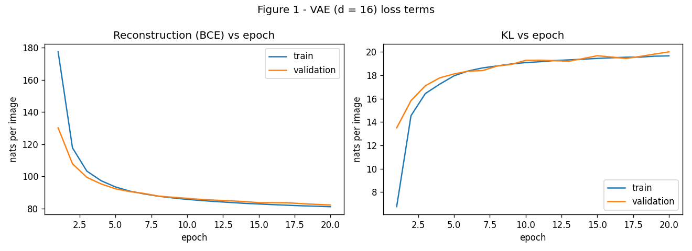
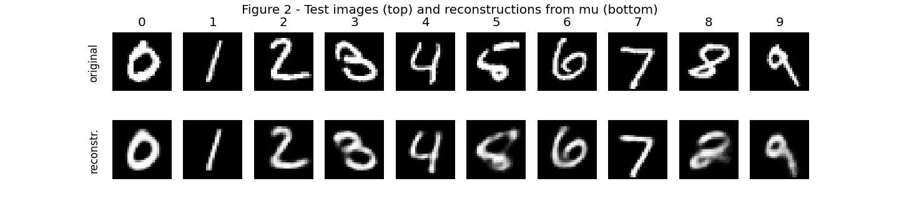
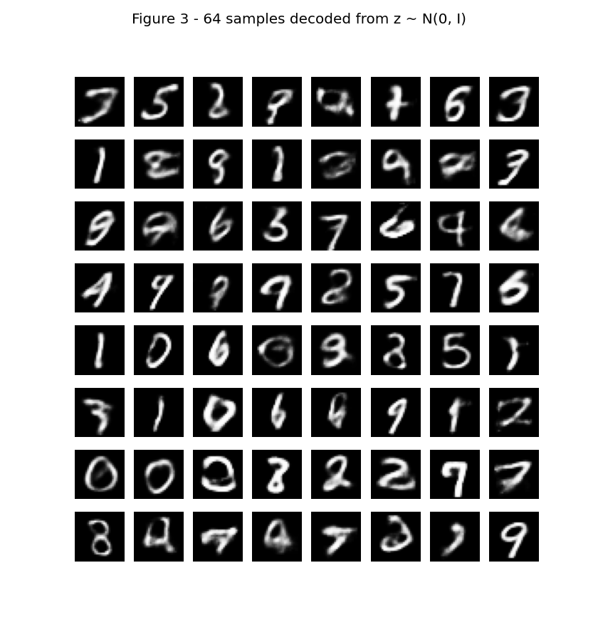
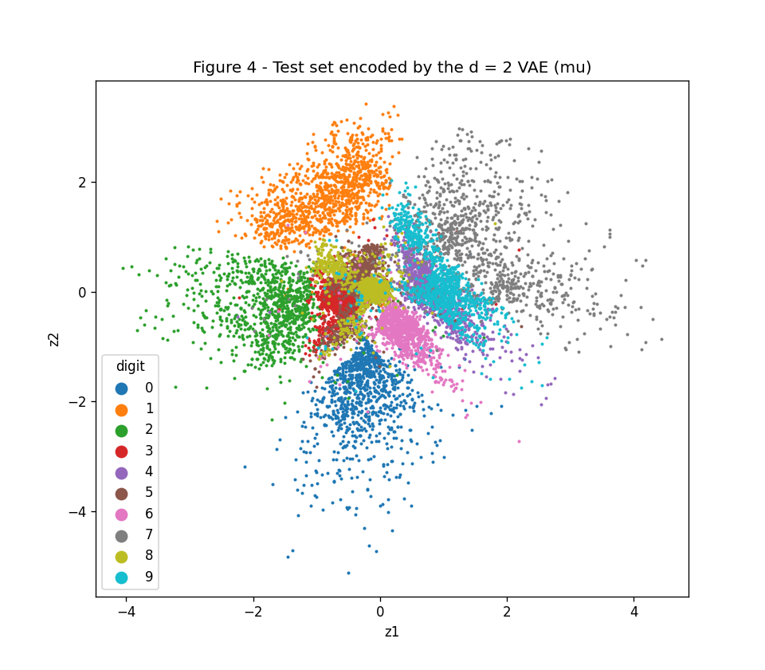
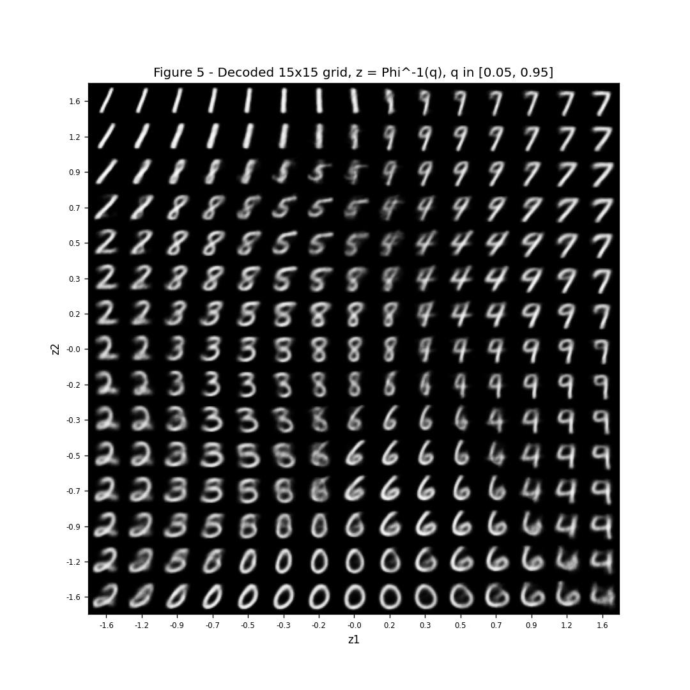
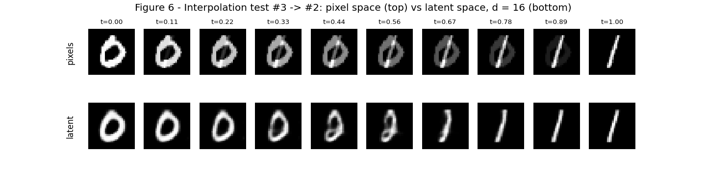

# VAE: Variational Autoencoders on MNIST

**Course:** Insper ANN/DL 2026.2. **Author:** Stefano Lindenbojm

Rules followed: `torch.manual_seed(42)` before building each model; train/validation split with `random_split` and `torch.Generator().manual_seed(42)`; the test set is only used for the final numbers of each model. The **reparameterization, both loss terms (BCE and closed-form KL) and the sampling are hand-written**. No VAE library and no `torch.distributions` are used. All losses are in **nats per image** (summed over the 784 pixels or the d latent dimensions, averaged over images).

To re-run (from the repository root; MNIST is downloaded automatically to `docs/vae/data/`):

```bash
pip install -r requirements.txt
python3 docs/vae/code/ex1_vae_d16.py   # Exercise 1 (also saves the d = 16 model)
python3 docs/vae/code/ex2_vae_d2.py    # Exercise 2 (uses the d = 16 model for Figure 6)
```

Shared code: model, loss and training loop (`code/vae.py`):

```python
# VAE on MNIST (shared by Exercises 1 and 2).
# Hand-written parts: reparameterization, BCE reconstruction, closed-form KL, sampling.
import os
import torch
import torch.nn as nn
import torch.nn.functional as F
from torch.utils.data import DataLoader, random_split
from torchvision import datasets, transforms

HERE = os.path.dirname(os.path.abspath(__file__))
DATA_DIR = os.path.join(HERE, "..", "data")          # MNIST is downloaded here
FIG = os.path.join(HERE, "..", "figures")


def load_mnist():
    """Train (50k) / validation (10k) / test (10k). Images are 784-vectors in [0, 1]."""
    tf = transforms.Compose([transforms.ToTensor(),                  # pixels in [0, 1]
                             transforms.Lambda(lambda x: x.view(-1))])  # 28x28 -> 784
    full_train = datasets.MNIST(DATA_DIR, train=True, download=True, transform=tf)
    test = datasets.MNIST(DATA_DIR, train=False, download=True, transform=tf)
    train, val = random_split(full_train, [50000, 10000],
                              generator=torch.Generator().manual_seed(42))
    return train, val, test


class VAE(nn.Module):
    def __init__(self, d):
        super().__init__()
        # encoder 784 -> 512 -> 256 (ReLU), then two heads 256 -> d
        self.enc = nn.Sequential(nn.Linear(784, 512), nn.ReLU(),
                                 nn.Linear(512, 256), nn.ReLU())
        self.mu_head = nn.Linear(256, d)
        self.logvar_head = nn.Linear(256, d)
        # decoder d -> 256 -> 512 -> 784, sigmoid output (pixel probabilities)
        self.dec = nn.Sequential(nn.Linear(d, 256), nn.ReLU(),
                                 nn.Linear(256, 512), nn.ReLU(),
                                 nn.Linear(512, 784), nn.Sigmoid())

    def encode(self, x):
        h = self.enc(x)
        return self.mu_head(h), self.logvar_head(h)

    def reparameterize(self, mu, logvar):
        # z = mu + sigma * eps, eps ~ N(0, I).  sigma = exp(logvar / 2)
        eps = torch.randn_like(mu)
        return mu + torch.exp(0.5 * logvar) * eps

    def decode(self, z):
        return self.dec(z)

    def forward(self, x):
        mu, logvar = self.encode(x)
        z = self.reparameterize(mu, logvar)
        return self.decode(z), mu, logvar


def loss_terms(x_hat, x, mu, logvar):
    """Both terms in nats per image (summed over pixels / latent dims, averaged over the batch)."""
    n = x.shape[0]
    recon = F.binary_cross_entropy(x_hat, x, reduction="sum") / n
    kl = 0.5 * torch.sum(mu ** 2 + logvar.exp() - 1 - logvar) / n
    return recon, kl


@torch.no_grad()
def evaluate(model, dataset):
    """Average reconstruction and KL (nats/image) over a whole dataset."""
    model.eval()
    recon_sum, kl_sum, n = 0.0, 0.0, 0
    for x, _ in DataLoader(dataset, batch_size=1000):
        x_hat, mu, logvar = model(x)
        recon, kl = loss_terms(x_hat, x, mu, logvar)
        recon_sum += recon.item() * len(x)
        kl_sum += kl.item() * len(x)
        n += len(x)
    return recon_sum / n, kl_sum / n


def train_vae(d, train, val, epochs=20, beta=1.0, lr=1e-3, batch_size=128):
    torch.manual_seed(42)                       # seed before building each model
    model = VAE(d)
    opt = torch.optim.Adam(model.parameters(), lr=lr)
    loader = DataLoader(train, batch_size=batch_size, shuffle=True)
    hist = {"train_recon": [], "train_kl": [], "val_recon": [], "val_kl": []}

    for epoch in range(epochs):
        model.train()
        recon_sum, kl_sum, n = 0.0, 0.0, 0
        for x, _ in loader:
            x_hat, mu, logvar = model(x)
            recon, kl = loss_terms(x_hat, x, mu, logvar)
            loss = recon + beta * kl            # negative ELBO (beta = 1)
            opt.zero_grad()
            loss.backward()
            opt.step()
            recon_sum += recon.item() * len(x)
            kl_sum += kl.item() * len(x)
            n += len(x)
        val_recon, val_kl = evaluate(model, val)
        hist["train_recon"].append(recon_sum / n)
        hist["train_kl"].append(kl_sum / n)
        hist["val_recon"].append(val_recon)
        hist["val_kl"].append(val_kl)
        print(f"d={d} epoch {epoch + 1:2d}: train recon {recon_sum / n:.2f}  KL {kl_sum / n:.2f} | "
              f"val recon {val_recon:.2f}  KL {val_kl:.2f}")
    return model, hist
```

[View `vae.py` on GitHub](https://github.com/stefanolinden/exercises/blob/main/docs/vae/code/vae.py)

## Exercise 1

Script (`code/ex1_vae_d16.py`):

```python
# Exercise 1 - VAE on MNIST with d = 16
import os
import torch
import matplotlib.pyplot as plt
from vae import load_mnist, train_vae, evaluate, FIG, HERE

# ---------- A. Data ----------
train, val, test = load_mnist()
print(f"train {len(train)}, val {len(val)}, test {len(test)}")

# ---------- B + C. Model and training ----------
model, hist = train_vae(d=16, train=train, val=val)
torch.save(model.state_dict(), os.path.join(HERE, "vae_d16.pt"))   # reused in Exercise 2D

# test set used only here, for the final numbers
test_recon, test_kl = evaluate(model, test)
print(f"TEST d=16: recon {test_recon:.2f}, KL {test_kl:.2f}, negative ELBO {test_recon + test_kl:.2f}")
print(f"Validation KL: first epoch {hist['val_kl'][0]:.2f}, last epoch {hist['val_kl'][-1]:.2f}")

# Figure 1: the two loss terms per epoch
epochs = range(1, len(hist["train_recon"]) + 1)
fig, ax = plt.subplots(1, 2, figsize=(11, 4))
ax[0].plot(epochs, hist["train_recon"], label="train")
ax[0].plot(epochs, hist["val_recon"], label="validation")
ax[0].set_title("Reconstruction (BCE) vs epoch")
ax[0].set_xlabel("epoch"); ax[0].set_ylabel("nats per image"); ax[0].legend()
ax[1].plot(epochs, hist["train_kl"], label="train")
ax[1].plot(epochs, hist["val_kl"], label="validation")
ax[1].set_title("KL vs epoch")
ax[1].set_xlabel("epoch"); ax[1].set_ylabel("nats per image"); ax[1].legend()
fig.suptitle("Figure 1 - VAE (d = 16) loss terms")
fig.tight_layout(); fig.savefig(f"{FIG}/fig1.png", dpi=120); plt.close(fig)

# ---------- D. Reconstructions and samples ----------
model.eval()
with torch.no_grad():
    # first test image of each digit 0..9
    labels = test.targets
    idx = [int((labels == k).nonzero()[0]) for k in range(10)]
    print("First test index of each digit 0-9:", idx)
    x = torch.stack([test[i][0] for i in idx])
    mu, _ = model.encode(x)
    x_rec = model.decode(mu)                  # decode the mean, not a sample

    fig, ax = plt.subplots(2, 10, figsize=(12, 2.8))
    for k in range(10):
        ax[0, k].imshow(x[k].view(28, 28), cmap="gray")
        ax[1, k].imshow(x_rec[k].view(28, 28), cmap="gray")
        ax[0, k].set_title(str(k))
        ax[0, k].axis("off"); ax[1, k].axis("off")
    ax[0, 0].text(-12, 14, "original", rotation=90, va="center")
    ax[1, 0].text(-12, 14, "reconstr.", rotation=90, va="center")
    fig.suptitle("Figure 2 - Test images (top) and reconstructions from mu (bottom)")
    fig.savefig(f"{FIG}/fig2.png", dpi=120); plt.close(fig)

    # 64 samples from the prior z ~ N(0, I)
    torch.manual_seed(0)
    z = torch.randn(64, 16)
    samples = model.decode(z)
    fig, ax = plt.subplots(8, 8, figsize=(7, 7.4))
    for i in range(64):
        ax[i // 8, i % 8].imshow(samples[i].view(28, 28), cmap="gray")
        ax[i // 8, i % 8].axis("off")
    fig.suptitle("Figure 3 - 64 samples decoded from z ~ N(0, I)")
    fig.savefig(f"{FIG}/fig3.png", dpi=120); plt.close(fig)
```

[View `ex1_vae_d16.py` on GitHub](https://github.com/stefanolinden/exercises/blob/main/docs/vae/code/ex1_vae_d16.py)

### A

MNIST is loaded with `transforms.ToTensor()`, so pixels are in [0, 1], and each image is flattened to a 784-vector. The 60,000 official training images are split with `random_split(..., [50000, 10000], generator=torch.Generator().manual_seed(42))` into **50,000 train** and **10,000 validation** images. The **10,000 official test images** are the test set. They are used only for the final numbers of each model (`evaluate(model, test)`, called once after training). Every training decision uses the validation set.

### B

- **Encoder:** 784 → 512 → 256, ReLU after each layer. Then two linear heads 256 → d, one for **μ** and one for **log σ²**.
- **Decoder:** d → 256 → 512 → 784, ReLU on the hidden layers, **sigmoid** at the output (each output is the probability that a pixel is "on").
- **Latent dimension:** d = 16.
- **Reparameterization** (`VAE.reparameterize`): `z = μ + σ ⊙ ε`, with `σ = exp(½ log σ²)` and `ε ~ N(0, I)`. All the randomness is in ε, so gradients can flow through μ and σ.
- **Reconstruction term:** binary cross-entropy summed over the 784 pixels, `F.binary_cross_entropy(x_hat, x, reduction="sum") / batch_size`. BCE is the negative log-likelihood of a Bernoulli decoder, which fits MNIST's almost-binary pixels.
- **KL term** (closed form, written out): `KL = ½ Σᵢ (μᵢ² + σᵢ² − 1 − log σᵢ²)`, summed over the d dimensions and divided by the batch size.
- **Total loss:** `reconstruction + β·KL` with **β = 1** (the negative ELBO), averaged over the batch.

### C

Adam, learning rate 10⁻³, batch size 128, **20 epochs**. After each epoch the reconstruction and KL terms are recorded on the training set (epoch average) and on the validation set. Training took about 3 minutes on a laptop CPU.

**Test-set results (d = 16):**
- Reconstruction = **81.45 nats/image**
- KL = **20.11 nats/image**
- Negative ELBO = 81.45 + 20.11 = **101.57 nats/image**

Validation KL: **13.50 nats** after epoch 1 and **20.01 nats** after epoch 20. Validation reconstruction went from 130.15 to 82.15 nats.

**Figure 1**



### D

**Figure 2:** the first test image of each digit 0–9 (test indices 3, 2, 1, 18, 4, 8, 11, 0, 61, 7) on top, and the reconstruction decoded from **μ** below.



**Figure 3:** 64 images decoded from z ~ N(0, I), drawn after `torch.manual_seed(0)`.



### E

**1. Why does the KL rise while the total loss falls?** At the start the encoder is random and its outputs are close to the prior (μ ≈ 0, σ ≈ 1), so the KL is small (6.75 nats in the training average of epoch 1) but the reconstruction is very bad (177 nats). To reconstruct well, the encoder must give each image its **own** code: move μ away from 0 and shrink σ so different images don't mix. Each of these steps costs KL, but it saves much more in reconstruction. From epoch 1 to epoch 20 the validation KL went **up by 6.5 nats** (13.50 → 20.01) while the validation reconstruction went **down by 48 nats** (130.15 → 82.15). The optimizer minimizes the **sum**, so it accepts paying more KL as long as the reconstruction drops by more. The KL is the "price" of storing information about the image in z.

**2. Why is Figure 3 worse than Figure 2? Two distinct reasons:**

- **Where prior samples land (latent space):** the encoder never fills N(0, I) exactly. The aggregate posterior (all the μ's of the training images) has "holes" and low-density regions between the digit clusters, and the KL is not zero (≈ 20 nats), so q(z) ≠ p(z). A random z ~ N(0, I) can fall in one of these regions, where the decoder saw few or no training codes. It then decodes something between digits, or not a digit at all. In Figure 2, z = μ of a real image, which is a place the decoder was trained on.
- **What the decoder outputs for a given z:** the decoder outputs the **mean** (the pixel probabilities) of p(x|z), not a sample. Under BCE, when one z could correspond to several slightly different images (stroke thickness, exact position), the best output is their **average**, and an average of many images is blurry. Prior samples are more uncertain codes, so they average over more possibilities and come out blurrier.

**3. Why decode μ and not a sampled z for Figure 2?** μ is the encoder's best estimate (the center) of the code of that image. A sampled z = μ + σε adds random noise, so the reconstruction would change every time we run it and would be slightly worse. Decoding μ gives a deterministic picture that shows what the model actually learned about that image, without sampling noise.

## Exercise 2

Script (`code/ex2_vae_d2.py`):

```python
# Exercise 2 - A latent space you can see (d = 2)
# Run ex1_vae_d16.py first: Figure 6 uses the saved d = 16 model.
import os
import numpy as np
import torch
import matplotlib.pyplot as plt
from scipy.stats import norm
from torch.utils.data import DataLoader
from vae import VAE, load_mnist, train_vae, evaluate, FIG, HERE

train, val, test = load_mnist()

# ---------- A. Same model and training, only d = 2 ----------
model, hist = train_vae(d=2, train=train, val=val)
test_recon, test_kl = evaluate(model, test)
print(f"TEST d=2: recon {test_recon:.2f}, KL {test_kl:.2f}, negative ELBO {test_recon + test_kl:.2f}")
model.eval()

# ---------- B. Encoded test set (mu of every test image) ----------
with torch.no_grad():
    x_all, y_all = next(iter(DataLoader(test, batch_size=len(test))))
    mu_all, _ = model.encode(x_all)
mu_all, y_all = mu_all.numpy(), y_all.numpy()

plt.figure(figsize=(8, 7))
for k in range(10):
    plt.scatter(mu_all[y_all == k, 0], mu_all[y_all == k, 1], s=2, color=plt.cm.tab10(k), label=str(k))
plt.title("Figure 4 - Test set encoded by the d = 2 VAE (mu)")
plt.xlabel("z1"); plt.ylabel("z2")
plt.legend(title="digit", markerscale=6)
plt.savefig(f"{FIG}/fig4.png", dpi=120); plt.close()

# ---------- C. Decoded plane on a 15x15 grid spaced by the prior's quantiles ----------
q = np.linspace(0.05, 0.95, 15)
z_vals = norm.ppf(q)                      # inverse CDF of N(0, 1)
canvas = np.zeros((15 * 28, 15 * 28))
with torch.no_grad():
    for r, z2 in enumerate(z_vals[::-1]):          # top row = largest z2 (like a plot)
        for c, z1 in enumerate(z_vals):            # left column = smallest z1
            img = model.decode(torch.tensor([[z1, z2]], dtype=torch.float32))
            canvas[r * 28:(r + 1) * 28, c * 28:(c + 1) * 28] = img.view(28, 28).numpy()

ticks = np.arange(15) * 28 + 14
plt.figure(figsize=(9, 9))
plt.imshow(canvas, cmap="gray")
plt.xticks(ticks, [f"{v:.1f}" for v in z_vals], fontsize=7)
plt.yticks(ticks, [f"{v:.1f}" for v in z_vals[::-1]], fontsize=7)
plt.title("Figure 5 - Decoded 15x15 grid, z = Phi^-1(q), q in [0.05, 0.95]")
plt.xlabel("z1"); plt.ylabel("z2")
plt.savefig(f"{FIG}/fig5.png", dpi=120); plt.close()

# ---------- D. Interpolation: pixel space vs latent space (d = 16 model) ----------
ia, ib = 3, 2                      # test index 3 is a "0", test index 2 is a "1"
print(f"Interpolating test index {ia} (digit {test[ia][1]}) -> index {ib} (digit {test[ib][1]})")
xa, xb = test[ia][0], test[ib][0]

model16 = VAE(16)
model16.load_state_dict(torch.load(os.path.join(HERE, "vae_d16.pt")))
model16.eval()

ts = np.linspace(0, 1, 10)
with torch.no_grad():
    mu_a, _ = model16.encode(xa.unsqueeze(0))
    mu_b, _ = model16.encode(xb.unsqueeze(0))
    pixel_row = [(1 - t) * xa + t * xb for t in ts]
    latent_row = [model16.decode((1 - t) * mu_a + t * mu_b)[0] for t in ts]

fig, ax = plt.subplots(2, 10, figsize=(12, 3))
for j, t in enumerate(ts):
    ax[0, j].imshow(pixel_row[j].view(28, 28), cmap="gray")
    ax[1, j].imshow(latent_row[j].view(28, 28), cmap="gray")
    ax[0, j].set_title(f"t={t:.2f}", fontsize=8)
    ax[0, j].axis("off"); ax[1, j].axis("off")
ax[0, 0].text(-14, 14, "pixels", rotation=90, va="center")
ax[1, 0].text(-14, 14, "latent", rotation=90, va="center")
fig.suptitle(f"Figure 6 - Interpolation test #{ia} -> #{ib}: pixel space (top) vs latent space, d = 16 (bottom)")
fig.savefig(f"{FIG}/fig6.png", dpi=120); plt.close(fig)
```

[View `ex2_vae_d2.py` on GitHub](https://github.com/stefanolinden/exercises/blob/main/docs/vae/code/ex2_vae_d2.py)

### A

Same architecture, data, seed (`torch.manual_seed(42)`), β = 1, Adam 10⁻³, batch 128 and 20 epochs. **Only d = 2** changed.

| Model | Test reconstruction | Test KL | Negative ELBO |
|---|---|---|---|
| d = 16 (Ex. 1) | 81.45 nats | 20.11 nats | 101.57 nats |
| d = 2 (Ex. 2) | **133.98 nats** | **6.78 nats** | 140.77 nats |

With d = 2 the reconstruction is **52.5 nats worse**, and the KL is 13.3 nats smaller, because the model can store much less information in z.

### B

**Figure 4:** μ of all 10,000 test images, colored by digit.



### C

**Figure 5:** decoded 15×15 grid. Each coordinate is z = Φ⁻¹(q), with q taking 15 evenly spaced values in [0.05, 0.95] (`scipy.stats.norm.ppf`). Values go from −1.64 to +1.64; z1 increases to the right and z2 increases upward.



**Why this spacing:** since q is evenly spaced, each step in z covers the same probability under N(0, 1) (the same area under the bell curve), so every cell of the grid holds the same prior mass. The grid is dense near 0, where most codes are, and sparse in the tails.

### D

Interpolated test images: **index 3 (a "0")** and **index 2 (a "1")**. t = 0, 1/9, …, 1 (10 steps). Top row: pixel space `(1 − t)·x_a + t·x_b`. Bottom row: latent space with the **d = 16 model from Exercise 1**, decoding `(1 − t)·μ_a + t·μ_b`.

**Figure 6**



### E

**1. Overlaps.** In Figure 4 the clearest overlap is **4 and 9**: the purple 4s sit inside the cyan 9 cluster, around z1 ≈ 0.5 to 1.5, z2 ≈ −0.5 to 1. There is also a crowded center where **3, 5 and 8** (red, brown, olive) overlap around z1 ≈ −1 to 0, z2 ≈ −0.5 to 0.7. In Figure 5 the same transitions appear in the same places. On the right side (z1 ≈ 0.3 to 1.2) the images go smoothly from **4 to 9**: the in-between images are a 4 whose top is half closed, so they look like both a 4 and a 9. In the center, the images change from 3 to 5 to 8. The in-between images are blurry mixtures, for example a 5 with a faint closed lower loop, or a 3 that starts to close on the left like an 8.

**2. What does d = 2 throw away?** Two numbers per image are only enough to say **which digit** it is and one or two big style factors. In Figure 5 these are mainly the **slant** (the 1s go from leaning to upright, and the 7s change angle) and the **width/roundness** (thin 1s vs. wide 0s). Everything else is discarded: stroke thickness, small curls, the exact shape of a particular person's handwriting, and unusual ways of writing a digit. Every cell in Figure 5 is a clean, "average" digit. The model can only output these prototypes, so any test image is reconstructed as the nearest prototype. This explains the **+52.5 nats** of reconstruction loss compared to d = 16.

**3. Comparing the two rows of Figure 6.** The **latent row** passes through digit-like images: the 0 gets thinner and narrower, and turns into a slanted 1. The middle frames are still made of single connected pen strokes (one of them looks a bit like an 8 or a 3, a plausible digit in between). The **pixel row** does not: it is just the 0 fading out while the 1 fades in. Midway you see **two overlapping, half-transparent digits** (a gray 0 with a gray 1 on top), which is not a digit anyone would write. The reason is that real digit images do not lie on a straight line in pixel space: the average of two valid images is usually not a valid image. In the latent space, the decoder maps **every** point it was trained around to a full-contrast image of a digit, so a straight path between two codes stays on the "manifold" of digits.

## Results summary

| # | Quantity | Result |
|---|---|---|
| 1 | Ex. 1: test reconstruction, KL, and negative ELBO (d = 16) | Reconstruction 81.45 nats, KL 20.11 nats, negative ELBO 101.57 nats (per image) |
| 2 | Ex. 1: validation KL at the first and last epoch | 13.50 nats (epoch 1) → 20.01 nats (epoch 20) |
| 3 | Ex. 2: test reconstruction and KL (d = 2) | Reconstruction 133.98 nats, KL 6.78 nats (negative ELBO 140.77) |
| 4 | Ex. 2: the two test indices interpolated | Index 3 (digit 0) and index 2 (digit 1) |
